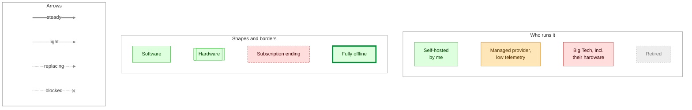
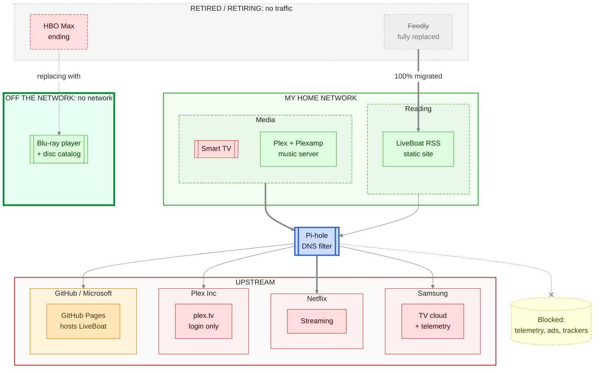
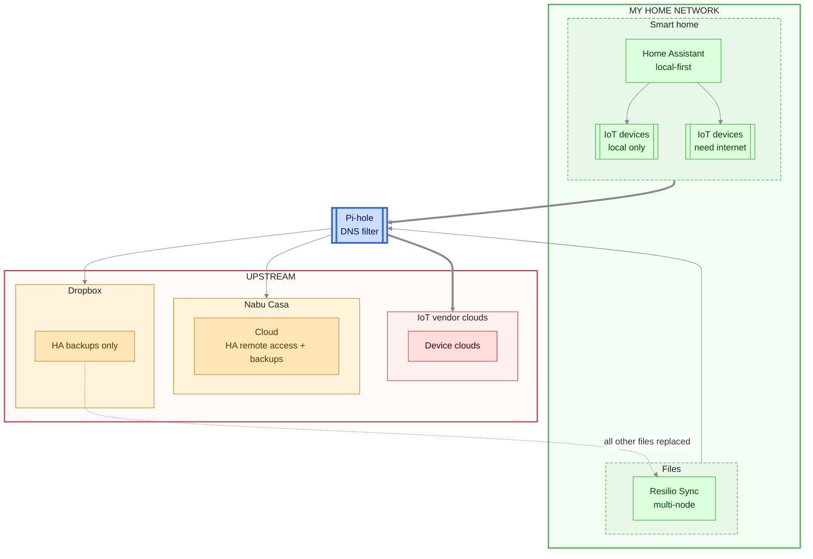
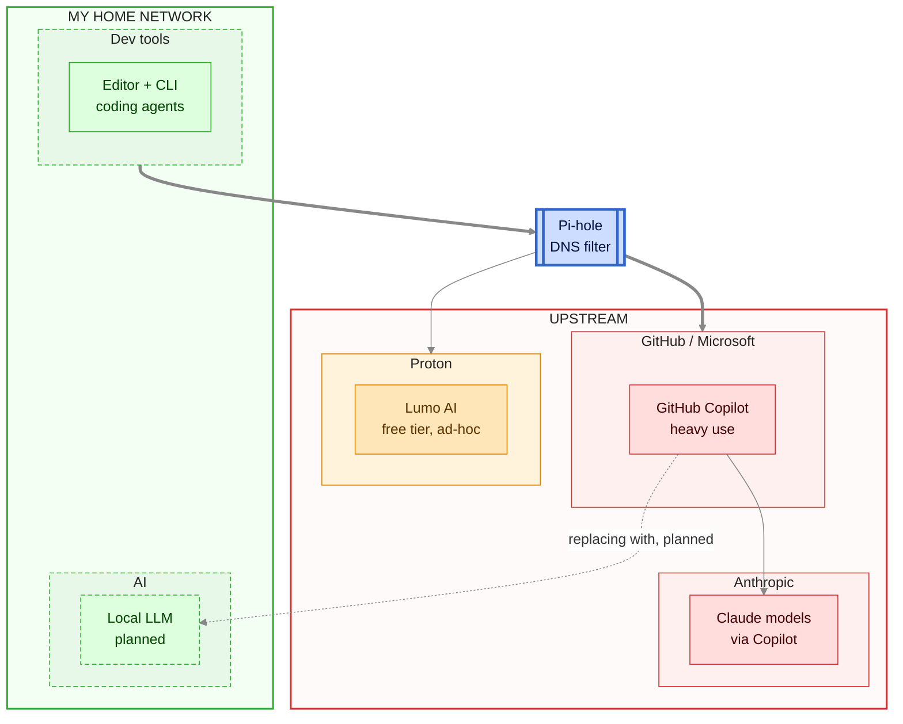

# Big Tech exit map

Four charts by domain. In each, my home is on top, a DNS filter sits in front of outbound traffic, and the upstream companies are below.

## Legend

## 1. Media and reading

## 2. Smart home and files

## 3. Personal admin and mobile

```mermaid
---
config:
  theme: base
  themeVariables:
    textColor: '#222222'
    titleColor: '#222222'
    edgeLabelBackground: '#ffffff'
    lineColor: '#888888'
---
flowchart TB
    subgraph home["MY HOME NETWORK"]
        direction LR

        subgraph h_mobile["Mobile"]
            direction TB
            pixel[[Smartphone<br/>on wifi]]
            gallery[Gallery app<br/>local photos]
            brave_m[Brave mobile]
        end

        subgraph h_desktop["Desktop"]
            direction TB
            chrome[Chrome desktop]
        end
    end

    pihole[[Pi-hole<br/>DNS filter]]

    subgraph out["UPSTREAM"]
        direction LR

        subgraph google["Google"]
            direction TB

            subgraph g_admin["Personal admin"]
                gmail[Gmail]
                gcal[Calendar]
            end

            subgraph g_photos["Photos"]
                gphotos[Google Photos]
            end

            subgraph g_mobile["Mobile"]
                gapps[Android / Play services]
                fi[Google Fi<br/>cellular]
            end
        end

        subgraph proton["Proton: personal admin"]
            direction TB
            pmail[Proton Mail]
            pcal[Proton Calendar]
        end

        subgraph bitwarden["Bitwarden: open source"]
            bw[Password manager]
        end

        subgraph brave["Brave"]
            bravecloud[Browser services]
        end
    end

    h_mobile ==> pihole
    h_desktop ==> pihole
    pihole ==> google
    pihole --> proton
    pihole --> bitwarden
    pihole --> brave

    pixel -. "on cellular: bypasses filter" .-> fi
    gmail -. "mid-migration" .-> pmail
    gcal -. "mid-migration" .-> pcal
    gphotos -. "mid-migration" .-> gallery

    classDef big fill:#fdd,stroke:#c33,color:#400
    classDef self fill:#dfd,stroke:#3a3,color:#040
    classDef gate fill:#cdf,stroke:#36c,stroke-width:3px,color:#014
    classDef hosted fill:#ffe6b8,stroke:#d98200,color:#5a3300
    class gmail,gcal,gapps,fi,gphotos,chrome big
    class pmail,pcal,bw,bravecloud,brave_m hosted
    class gallery self
    class pixel big
    class pihole gate
    style home fill:#f4fff4,stroke:#3a3,stroke-width:2px,color:#222
    style out fill:#fffafa,stroke:#c33,stroke-width:2px,color:#222
    style h_mobile fill:#e8f8e8,stroke:#3a3,stroke-dasharray: 5 3,color:#222
    style h_desktop fill:#e8f8e8,stroke:#3a3,stroke-dasharray: 5 3,color:#222
    style google fill:#fff0f0,stroke:#c33,color:#222
    style g_admin fill:#ffe0e0,stroke:#c33,stroke-dasharray: 5 3,color:#222
    style g_mobile fill:#ffe0e0,stroke:#c33,stroke-dasharray: 5 3,color:#222
    style proton fill:#fff3dc,stroke:#d98200,color:#222
    style bitwarden fill:#fff3dc,stroke:#d98200,color:#222
    style brave fill:#fff3dc,stroke:#d98200,color:#222
    style g_photos fill:#ffe0e0,stroke:#c33,stroke-dasharray: 5 3,color:#222
```

## 4. AI and dev tools

## Notes

- Orange = GitHub Pages, Dropbox (backups only), Nabu Casa, Proton (incl. Lumo), Bitwarden, Brave.
- Next: search, maps, other SaaS.
