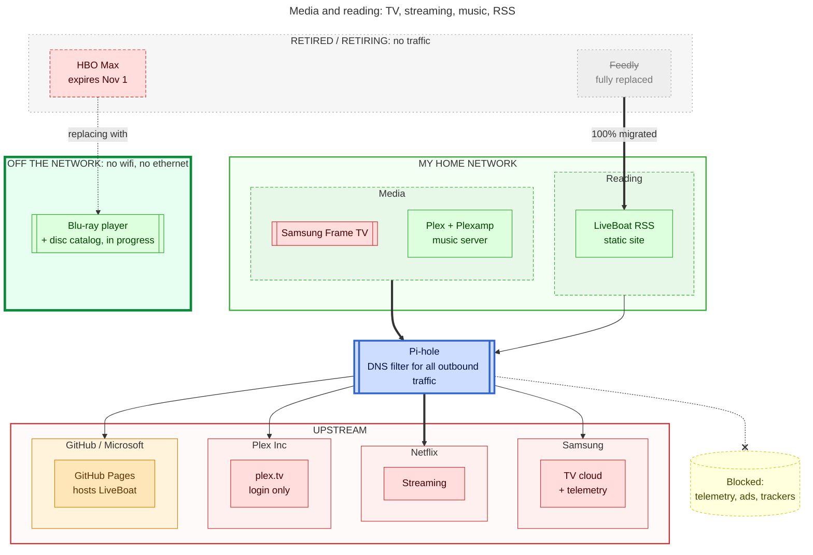
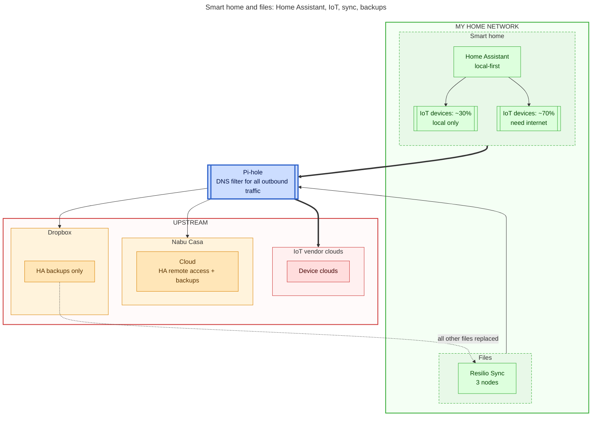
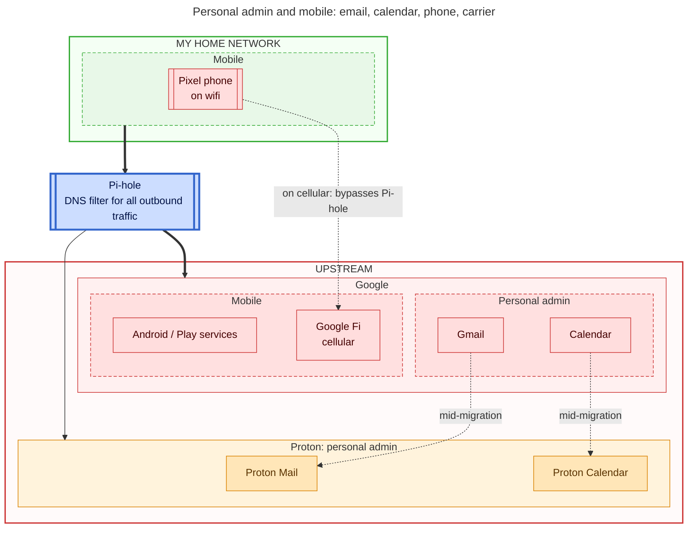

# Big Tech exit map (draft v7)

Three charts by domain. In each, my home is on top, the Pi-hole is the choke point for all outbound traffic, and the upstream companies are below.

## Legend

- Double border = hardware, single border = software/service
- Green = self-hosted by me, red = Big Tech (including their hardware on my network, like the Frame TV and Pixel), orange = managed hosting/provider with negligible telemetry (a flavor of self-hosting), grey = retired
- Thick arrow = steady traffic, thin arrow = light or filtered traffic
- Dotted red = blocked, dotted green = replacement in progress, dashed red box = subscription ending (HBO Max, Nov 1)
- Thick green box = fully offline, no network connection at all (Blu-ray player)

## 1. Media and reading

## 2. Smart home and files

## 3. Personal admin and mobile

## Notes

- Assumption: Google Fi on cellular skips Pi-hole. Delete that dotted edge if the phone always tunnels home.
- Orange = GitHub Pages, Dropbox (HA backups only), Nabu Casa, Proton.
- Next inputs: search/browser, password manager, maps, photos, other SaaS.
